<div align="center">

# 🎙️ VaaniOps

**Don't just talk to your enterprise. Get things done.**

A multilingual voice-to-action operations console for Indian banking. Customers speak in Hindi, Hinglish, Marathi or English, and VaaniOps transcribes the call, understands the issue, raises disputes or freezes cards through guarded tools, then confirms the result back in the customer's own voice. Every step goes into the audit trail.

[Live demo](https://vappiops.lovable.app) · [Architecture](#-system-architecture) · [Features](#-features) · [Getting started](#-getting-started)

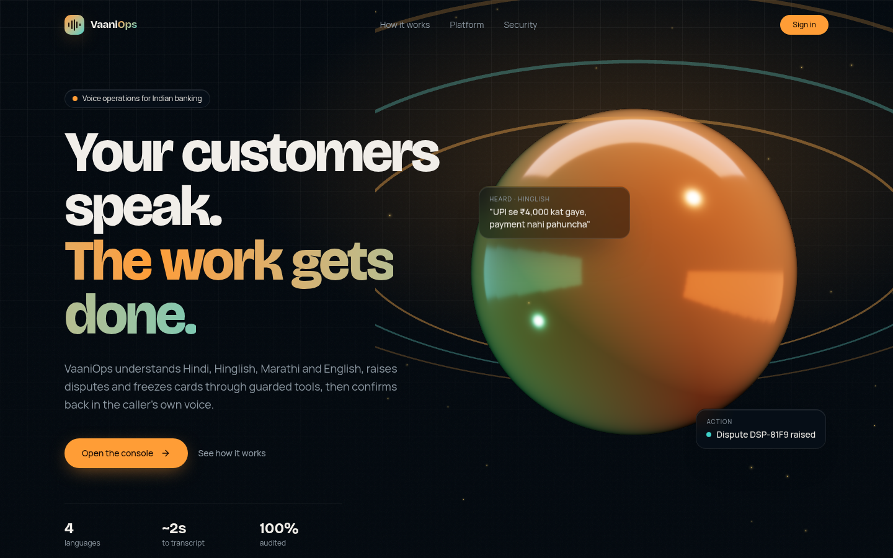

</div>

---

## ✨ Features

| Area | What it does |
| --- | --- |
| **Live Operations** | Mic or typed input → Gnani **Prisma v3** speech-to-text → AI intent reasoning → allowlisted tool calls → Gnani **Timbre v2.5** spoken reply, with a live execution trace |
| **AI Issue Triage** | Paste a transcript; the model returns language, intent, amount, merchant, risk and a *suggested* next action. It only suggests and never executes anything |
| **Dispute Management** | Full state machine: open → assigned → investigating → resolved/rejected → closed, with timestamps, operator notes and customer chat |
| **My Queue** | Each operator's open tickets, pending actions, recent chat and a "request more tickets" button |
| **AI Agent Studio** | Drag-and-drop agent flows with versioning and a dry-run test console |
| **Balances & ledger** | CSV import of real customers and transactions. Approved reversals credit balances through atomic database functions that write `ledger_entries` |
| **Team & Roles** | Admin / operator / viewer roles kept in a protected table and checked on the server |
| **Operator Performance** | Who claimed which ticket, when, and what they did, with per-operator metrics |
| **3D command center** | Real-time WebGL: a morphing glass orb, scroll-driven storytelling, interactive 3D bar and donut charts |
| **Audit & Security** | Append-only audit log and security events. Row-level security on every table |

## 📸 Screenshots

| Overview (3D charts) | Live Operations |
| --- | --- |
| 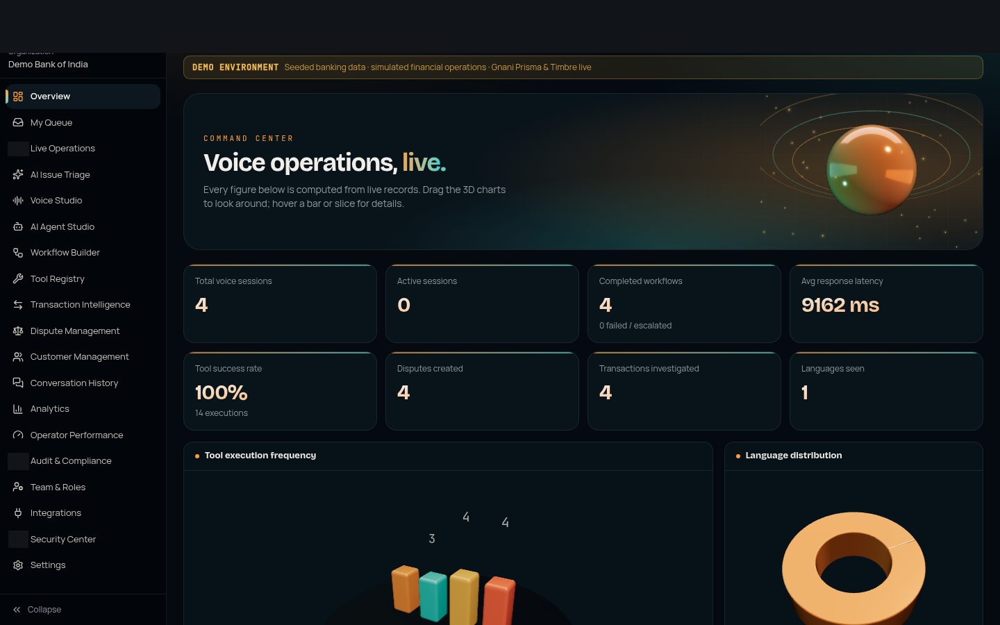 | 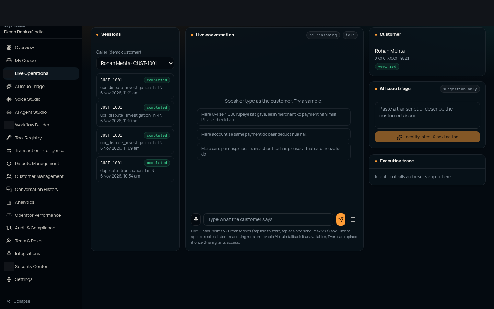 |
| **AI Issue Triage** | **Dispute Management** |
| 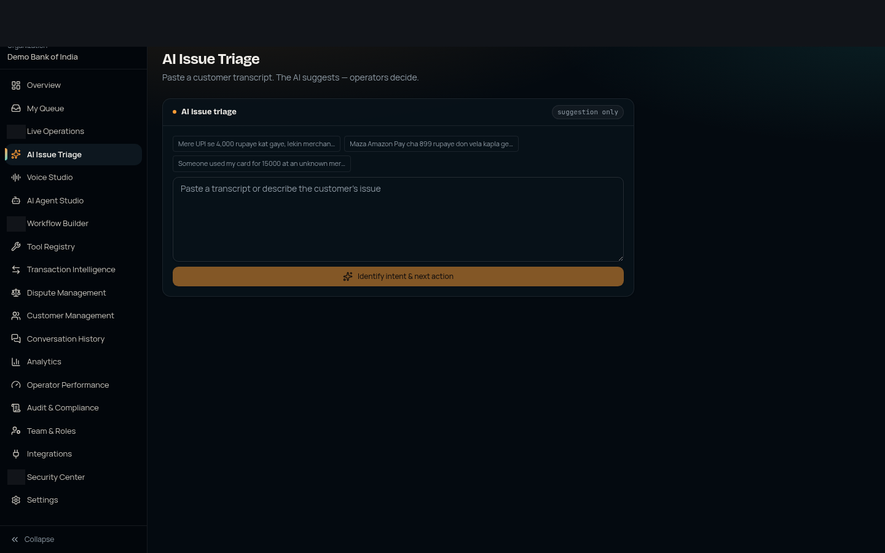 | 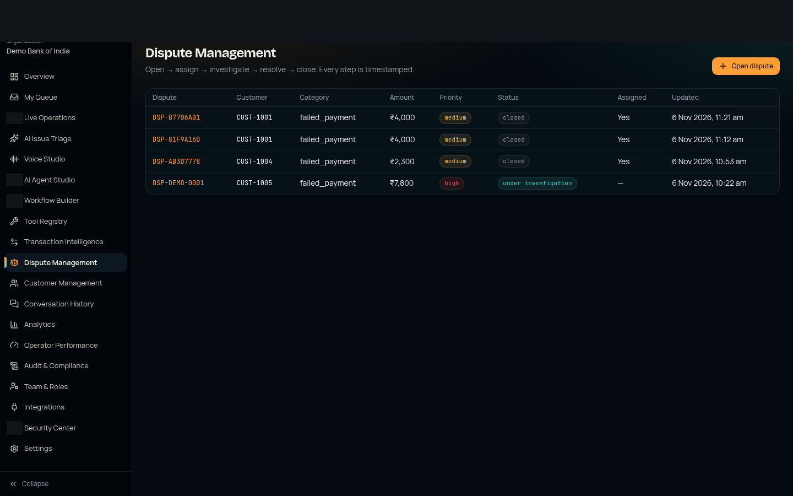 |
| **My Queue** | **AI Agent Studio** |
| 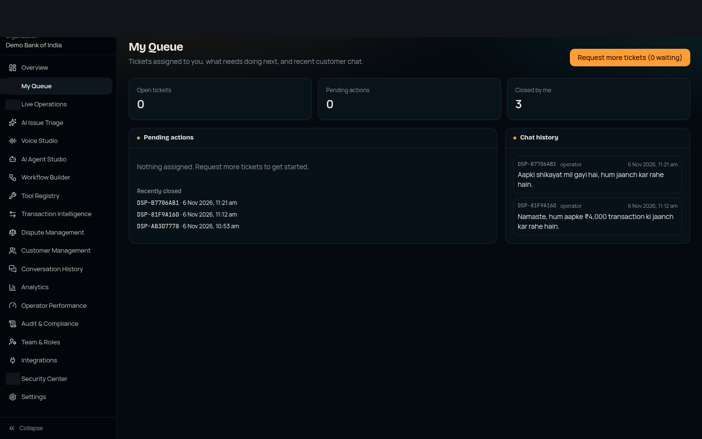 | 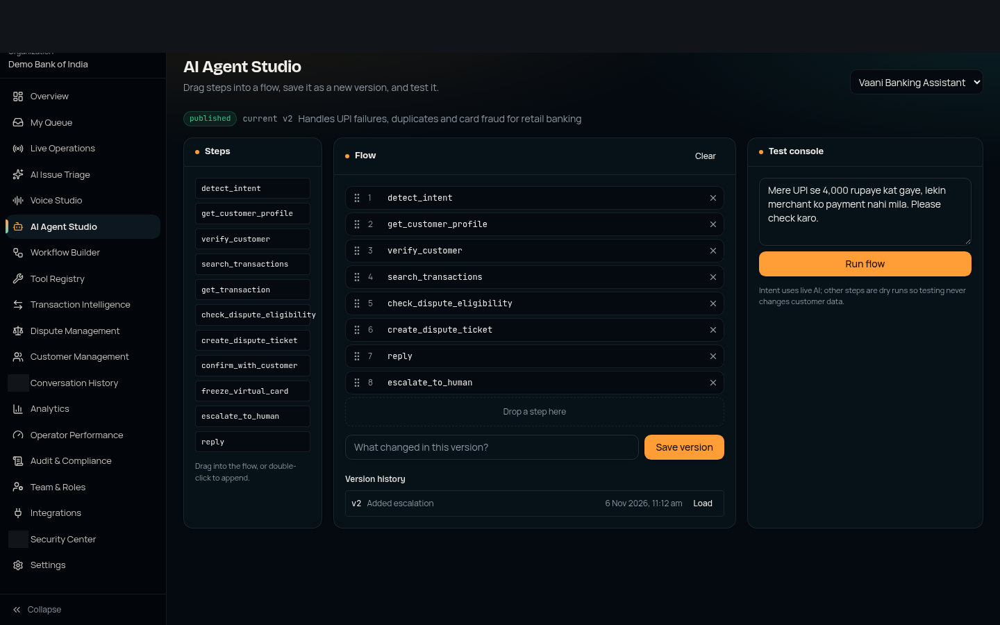 |
| **Operator Performance** | **Integrations** |
| 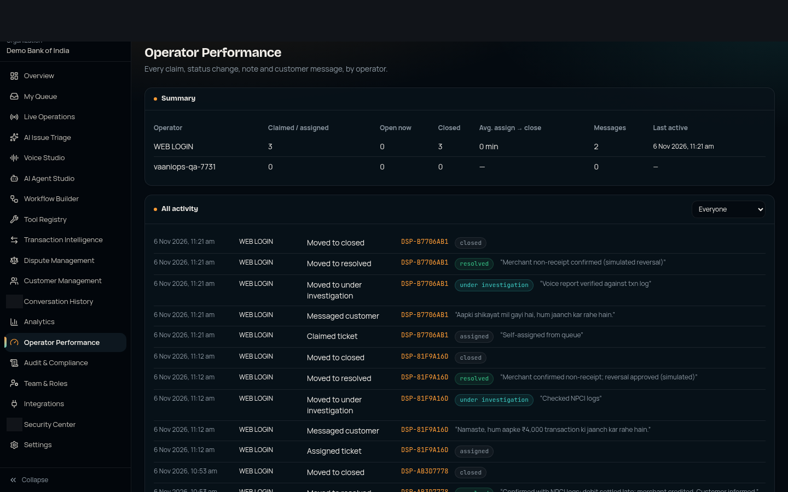 | 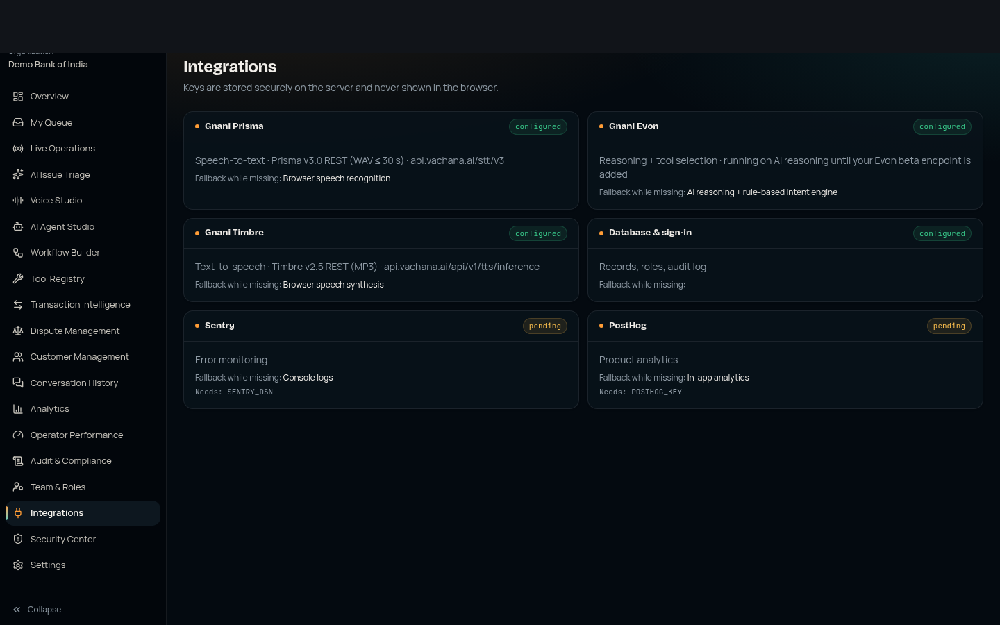 |

## 🏗 System architecture

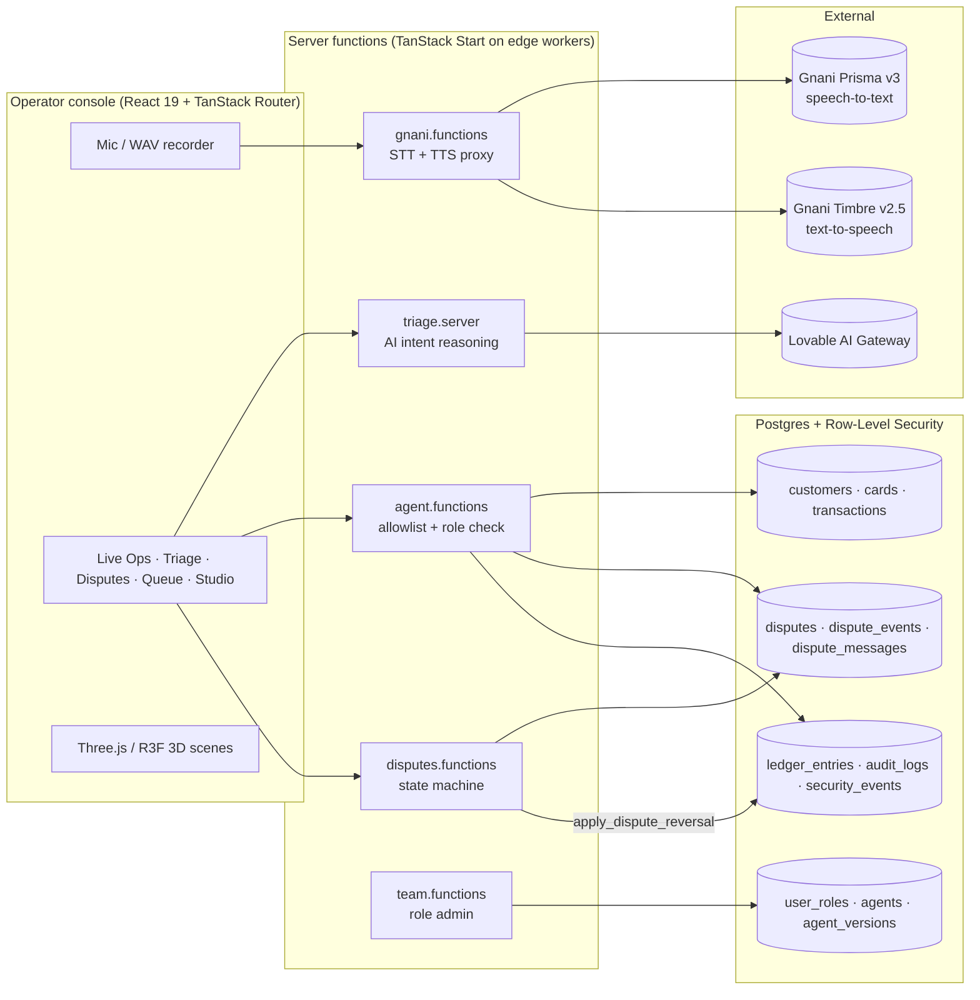

### The voice-to-action pipeline

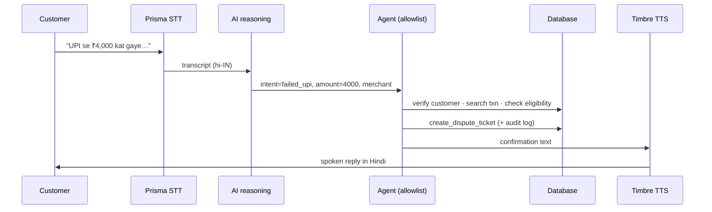

### Safety principles

- **The model never executes anything.** AI output is parsed against a strict schema and only *suggests* an action. Every tool runs through an allowlist in `src/lib/agent.functions.ts` with an independent role check.
- **Card freezes need confirmation.** The customer has to confirm before `freeze_virtual_card` runs, and Agent Studio rejects any flow without a confirm step.
- **One path for money.** Balances change only through the `apply_dispute_reversal` and `import_bank_data` database functions. Both are atomic and both write `ledger_entries`.
- **One enforced dispute state machine** (`src/lib/dispute-rules.ts`). Every transition is timestamped in `dispute_events` and `audit_logs`.
- **Keys stay server-side.** The Gnani key is read only inside server handlers.

## 🧰 Tech stack

- **Frontend:** React 19, TanStack Start / Router / Query, Tailwind CSS v4, shadcn/ui
- **3D & motion:** three.js, @react-three/fiber, @react-three/drei, SVG path morphing, scrollytelling
- **Backend:** TanStack server functions on edge workers, Postgres with row-level security, auth (email, Google)
- **Voice:** Gnani Prisma v3 (STT) and Timbre v2.5 (TTS)
- **AI:** Lovable AI Gateway with structured output; rule-based fallback in `src/lib/intent.ts`
- **Tests:** Vitest (`dispute-rules`, `intent`, `csv-import`, routing)

## 📁 Project structure

```text
src/
├── routes/
│   ├── index.tsx              # 3D landing page + scrollytelling
│   ├── auth.tsx               # sign in / sign up
│   └── _authenticated/        # console: overview, live, triage, disputes, my-queue,
│                              # agents, performance, team, import, integrations, …
├── components/
│   ├── three/                 # MorphScene (morphing orb), Charts3D (3D bars & donut)
│   ├── MorphMark.tsx          # SVG shape-morphing step icon
│   ├── kit.tsx                # Panel, Stat, DataTable, StatusBadge
│   └── ui/                    # shadcn components
└── lib/
    ├── gnani.functions.ts     # Prisma / Timbre proxy
    ├── triage.server.ts       # AI intent reasoning
    ├── agent.functions.ts     # allowlisted tool execution
    ├── disputes.functions.ts  # dispute workflow
    ├── dispute-rules.ts       # state machine (tested)
    ├── csv-import.ts          # bank data import (tested)
    └── wav-recorder.ts        # browser mic → WAV
```

## 🚀 Getting started

```bash
bun install
bun run dev        # http://localhost:8080
bunx vitest run    # tests
```

Server-side secrets the app uses: `GNANI_API_KEY` (Gnani Vachana key) and `LOVABLE_API_KEY` (AI gateway). Never commit them.

The first account to sign up becomes **admin**. Admins assign the operator and viewer roles on the **Team & Roles** page.

## 🗺 Roadmap

- [ ] Gnani **Evon** native intent model (waiting on beta endpoint access)
- [ ] Real-time streaming STT/TTS relay (needs an always-on socket server)
- [ ] Telephony (Exotel / Twilio) for real inbound calls
- [ ] Core-banking integration (balances currently live inside VaaniOps)

## 📄 License

Proprietary. All rights reserved.

## GitHub snapshot

This public repository is a source snapshot exported from Lovable. It is not linked to automatic two-way Git sync. Private environment files and operator email addresses in screenshots are excluded.
